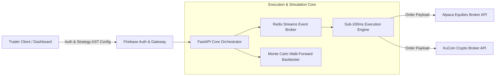

# SIRUS — System Architecture

SIRUS is a high-throughput, multi-tenant algorithmic trading and strategy simulation platform executing orders across equity and crypto markets.

## Architectural Highlights
- **Sub-100ms Event Pipeline**: Asynchronous order dispatch and market telemetry consumption orchestrated via Redis Streams.
- **Monte Carlo Strategy Validation**: 10,000+ iteration statistical backtesting with walk-forward risk modeling.
- **Multi-Broker Isolation**: Strict tenant segregation with sandboxed credential encryption and automated circuit-breakers.
