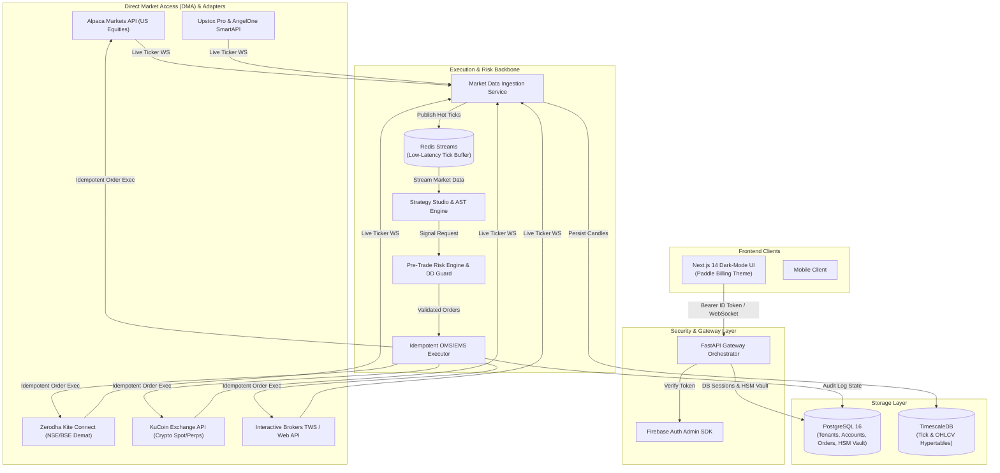

<div align="center">

# ⚡ SIRUS

### **Next-Generation Automated Multi-Tenant Quantitative Trading Engine**

[](https://nextjs.org/)
[](https://fastapi.tiangolo.com/)
[](https://tailwindcss.com/)
[](https://www.typescriptlang.org/)
[](https://www.timescale.com/)
[](https://redis.io/)
[](https://web-frontend-three-gamma.vercel.app)

<br />

**[Explore Live Demo](https://web-frontend-three-gamma.vercel.app)** • **[Architecture Docs](docs/ARCHITECTURE.md)** • **[API Specification](docs/API_SPECIFICATION.md)** • **[Security Model](docs/SECURITY_AND_COMPLIANCE.md)**

</div>

---

## 🌐 Live Production Deployments

| Production Target | Domain | Status |
| :--- | :--- | :--- |
| **Primary Production App** | [https://sirus-opal.vercel.app](https://sirus-opal.vercel.app) |  |
| **Mirror Instance (2man)** | [https://sirus-2man.vercel.app](https://sirus-2man.vercel.app) |  |
| **Web Frontend Gamma** | [https://web-frontend-three-gamma.vercel.app](https://web-frontend-three-gamma.vercel.app) |  |
| **Web Frontend Nu** | [https://web-frontend-eosin-nu.vercel.app](https://web-frontend-eosin-nu.vercel.app) |  |

---

## 🚀 Overview

**SIRUS** is an enterprise-grade, high-throughput quantitative trading platform built for systematic hedge funds, proprietary trading desks, and retail quantitative traders.

Engineered with asynchronous event-driven microservices, sub-millisecond market routing, and bank-grade HSM Demat credential security, SIRUS unifies equities (Alpaca, Zerodha, Upstox, Interactive Brokers, AngelOne, Groww) and cryptocurrency derivatives (KuCoin, Binance) into a single institutional execution surface.

### 🌟 Key Capabilities

- ⚡ **Direct Market Access (DMA) & Order Routing**: Sub-millisecond order dispatch with smart order routing (SOR) across Equities, Options/Futures, and Crypto.
- 🧪 **Vectorized Backtesting Studio**: Sub-100ms multi-year strategy simulations, Monte Carlo walk-forward equity curve projections, Sharpe ratio analysis, and maximum drawdown guards.
- 🛡️ **Pre-Trade Risk Engine & Circuit Breakers**: Atomic margin validation, dynamic ATR trailing stops, position concentration caps, and tenant-isolated risk envelopes.
- 🔐 **Bank-Grade Broker Demat Vault**: AES-256-GCM envelope encryption for Kite Connect, Alpaca DMA, and exchange API keys.
- 🎨 **Paddle Billing Aesthetic Design System**: High-contrast dark theme (`#0f1515`), Inter typography, dynamic SVG glow masks, ambient glassmorphism, and responsive financial data visualizations.

---

## 🏗️ System Architecture



---

## 📁 Repository Structure

```
SIRUS/
├── apps/
│   ├── api-gateway/              # Main FastAPI REST & WebSocket server
│   ├── market-data-service/      # Real-time WebSocket ticker ingestion service
│   ├── order-executor/           # Async OMS execution & state reconciliation
│   └── web-frontend/             # Next.js 14 Web Dashboard (Paddle Design System)
├── packages/
│   ├── broker-adapters/          # Alpaca, Zerodha, KuCoin, IBKR concrete adapters
│   ├── common-models/            # Unified Pydantic DTOs & Decimal math schemas
│   ├── database/                 # SQLAlchemy ORM, TimescaleDB hypertables, AES vault
│   ├── risk-core/                # Pre-trade risk limit validation engine
│   └── strategy-sdk/             # Base strategy classes, built-in algos, backtesting
├── docs/                         # Detailed System Specifications
│   ├── ARCHITECTURE.md           # System Microservices & Data Pipeline Spec
│   ├── API_SPECIFICATION.md      # REST & WebSocket API Documentation
│   ├── SECURITY_AND_COMPLIANCE.md# Security Architecture & Audit Report
│   └── ON_CALL_RUNBOOK.md        # Operations & Incident Recovery Playbook
├── infrastructure/
│   ├── docker/                   # Dockerfiles for microservices
│   └── kubernetes/               # Production K8s manifests and secrets
├── tests/                        # Platform unit & integration test suites
├── docker-compose.yml            # Local development orchestration stack
└── package.json                  # Root workspace configuration
```

---

## 💻 Local Development & Quick Start

### Prerequisites
- **Docker Engine** v24.0+ & **Docker Compose** v2.20+
- **Node.js** 18+ & **npm**
- **Python** 3.11+

### 1. Clone Repository
```bash
git clone https://github.com/arnnnnaaavvvvv/SIRUS.git
cd SIRUS
```

### 2. Run Local Microservices with Docker Compose
```bash
docker-compose up --build
```

### 3. Run Web Frontend Locally
```bash
cd apps/web-frontend
npm install
npm run dev
```
Open **[http://localhost:3000](http://localhost:3000)** in your browser.

---

## 🧪 Testing

Run comprehensive platform unit and integration test suites:

```bash
pytest tests/ -v
```

Tests validate:
- AES-256 envelope vault encryption and key derivation.
- Pre-trade margin limit checks, drawdown guards, and distributed Redis locks.
- Moving Average Crossover, RSI Reversion, and Donchian Breakout signal generators.
- Multi-broker adapter simulations (Alpaca, KuCoin, Zerodha Kite).
- Vectorized OHLCV backtesting engine accuracy.

---

## 📄 Documentation Directory

- [System Architecture Specification](docs/ARCHITECTURE.md)
- [REST & WebSocket API Specifications](docs/API_SPECIFICATION.md)
- [Security Model & Envelope Key Management](docs/SECURITY_AND_COMPLIANCE.md)
- [Operations & On-Call Runbook](docs/ON_CALL_RUNBOOK.md)

---

## 📜 License

Distributed under the MIT License. See `LICENSE` for more information.
