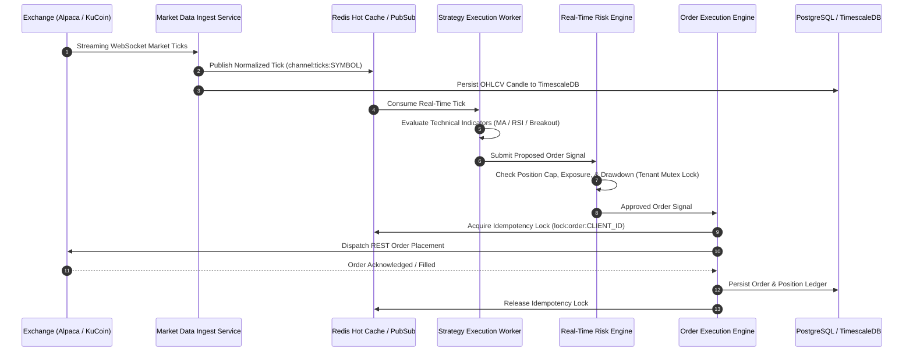
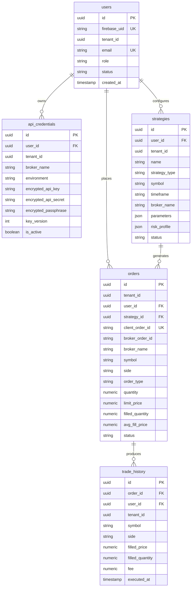

# System Architecture Specification

**Target Platform:** Multi-Tenant Automated Trading Platform  
**Architectural Style:** Event-Driven Microservices Architecture  
**Primary Language:** Python 3.11+ (Backend Services) / TypeScript (Next.js 14 Web Frontend)  

---

## 1. System Context & Data Flow Architecture

The platform architecture decouples real-time market data ingestion from signal generation, risk evaluation, and order execution.

---

## 2. Component Specifications

### 2.1 API Gateway (`apps/api-gateway`)
- **Technology:** FastAPI, Uvicorn, Pydantic, Structlog.
- **Responsibilities:**
  - Ingress point for HTTP REST requests and WebSockets.
  - Server-side Firebase ID token verification via Firebase Admin SDK with `check_revoked=True`.
  - Application of sliding-window rate limiters enforced via Redis Lua scripts.
  - Distribution of request context (`user_id`, `tenant_id`, `role`).

### 2.2 Market Data Ingestion Service (`apps/market-data-service`)
- **Technology:** Asyncio, HTTPX, Redis, TimescaleDB.
- **Responsibilities:**
  - Maintains resilient WebSocket connections to exchange venues.
  - Normalizes raw venue JSON frames into standard `MarketTick` models.
  - Broadcasts ticks to Redis channels and writes aggregated time-series candles to TimescaleDB.

### 2.3 Strategy Execution Workers (`apps/strategy-engine`)
- **Technology:** Python 3.11, Pandas, NumPy, TA-Lib.
- **Responsibilities:**
  - Subscribes to tick channels for active tenant symbols.
  - Maintains rolling indicator windows in memory.
  - Generates buy/sell signals based on strategy rules.

### 2.4 Real-Time Risk Engine (`packages/risk-core`)
- **Technology:** Python, Redis Distributed Mutex Locks.
- **Responsibilities:**
  - Pre-trade validation enforcing order size limits, portfolio exposure caps, and drawdown rules.
  - Post-trade position monitoring enforcing stop-loss, take-profit, and circuit breaker halts.

### 2.5 Order Execution Engine (`apps/order-executor`)
- **Technology:** Asyncio, Redis, Cryptography, SQLAlchemy Async.
- **Responsibilities:**
  - Translates approved signals into broker API calls.
  - Decrypts exchange keys from DB using envelope encryption.
  - Enforces client order ID idempotency and runs background reconciliation loops to synchronize order state.

---

## 3. Database Entity-Relationship Diagram

---

## 4. TimescaleDB Time-Series Hypertables

### 4.1 `market_ticks`
Partitioned by `time` (7-day interval chunks) and `symbol` (8 hash partitions):
- `time`: `TIMESTAMPTZ`
- `symbol`: `VARCHAR(32)`
- `exchange`: `VARCHAR(32)`
- `bid_price`: `NUMERIC(18, 8)`
- `ask_price`: `NUMERIC(18, 8)`
- `last_price`: `NUMERIC(18, 8)`
- `volume`: `NUMERIC(18, 8)`

### 4.2 `ohlcv_candles`
Continuous aggregate hypertable generating 1-minute, 5-minute, and 1-hour candles automatically from `market_ticks`.
